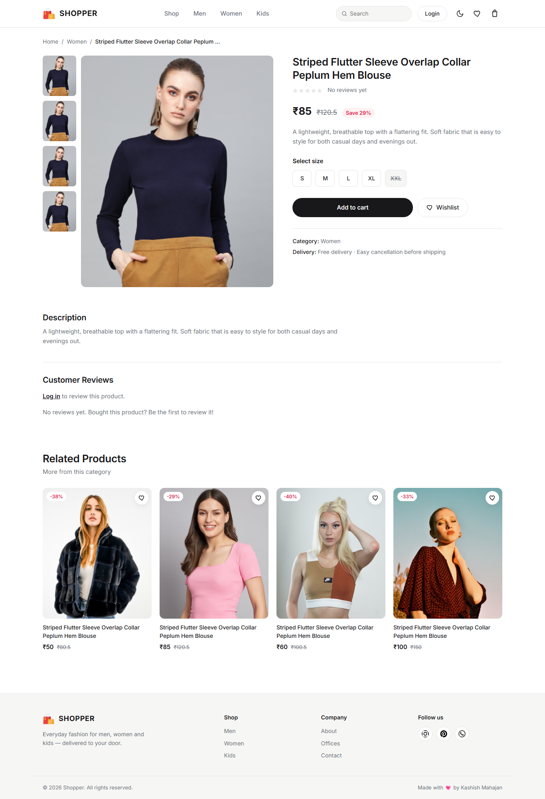
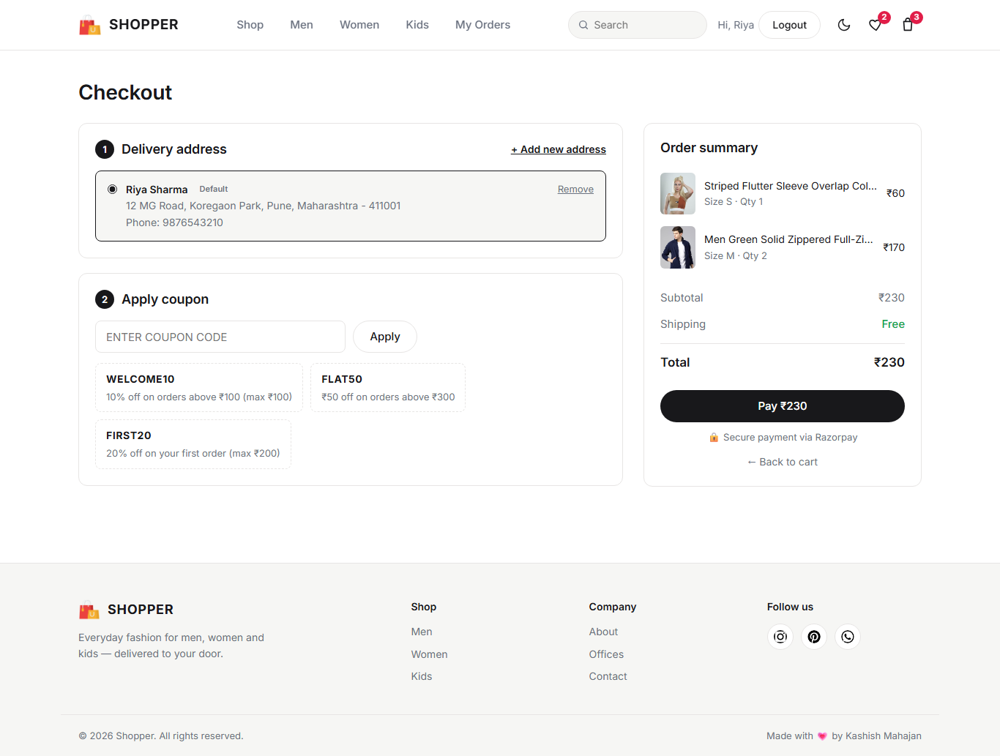
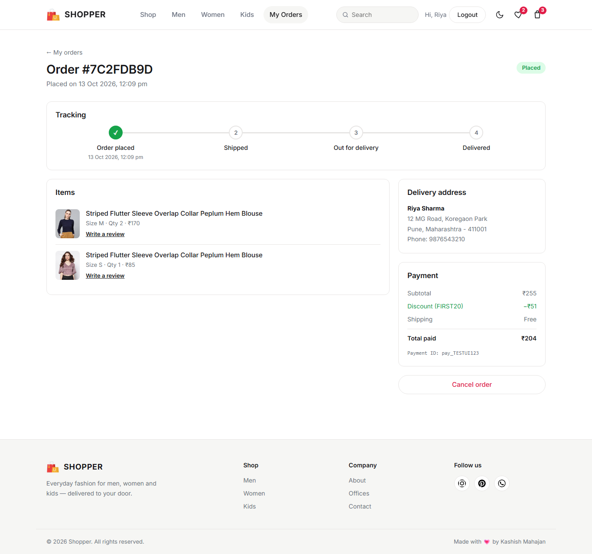
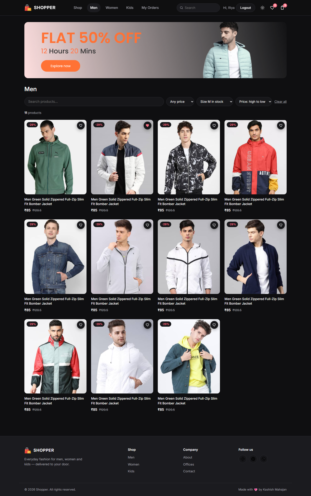

# 🛒 Shopper — Full-Stack MERN E-Commerce Store

A complete online fashion store built with **MongoDB, Express, React and Node.js**. Customers can browse and search products, save a wishlist, check out with a saved address and coupon, pay with **Razorpay**, track their order and cancel it with a refund. Their cart, wishlist and order history are saved to their account.


## ✨ Features
**Shopping**
- Product catalogue stored in MongoDB and served by a REST API
- Search, price and size filters, sorting and pagination (filters are kept in the URL so results can be shared)
- Stock tracked per size: sold-out sizes are disabled, "Only 2 left" warnings, stock reduced on payment and restored on cancellation
- Same product in several sizes in the cart
- Wishlist, recently viewed products and related products (same category)
- Ratings and reviews — only customers who bought a product can review it (verified purchase)

**Accounts**
- Signup/login with JWT; signup logs the user in straight away
- Forgot / reset password by email (single-use, 15-minute link; only a hash of the token is stored)
- Cart, wishlist and addresses are saved to the account and restored on any device; a guest cart is merged in on login

**Checkout & orders**
- Saved delivery addresses with validation (10-digit mobile, 6-digit pincode)
- Coupon codes checked on the server (`WELCOME10`, `FLAT50`, `FIRST20` — first order only)
- **Razorpay payments**: the amount is calculated on the server, the payment signature is verified (HMAC-SHA256), and a **webhook** records the payment even if the customer closes the browser
- Order tracking timeline (Placed → Shipped → Out for delivery → Delivered)
- Order cancellation with an automatic **Razorpay refund**
- Emails for signup, order confirmation, cancellation and password reset (Nodemailer)

**Quality**
- Security headers (Helmet), rate limiting on auth routes, input validation (Joi), configurable CORS
- Light / dark mode, responsive down to phone width, loading skeletons, toast notifications
- Automated tests: backend API (Jest + Supertest + in-memory MongoDB) and frontend user flows (React Testing Library)

## 🛠️ Tech Stack

| Layer | Technologies |
|---|---|
| Frontend | React 18, React Router 6, Context API, react-toastify, CSS variables (no UI library) |
| Backend | Node.js, Express 5, Mongoose, JWT, bcrypt, Joi, Helmet, express-rate-limit, Nodemailer |
| Payments | Razorpay Orders API, signature verification, webhooks, refunds |
| Database | MongoDB Atlas |
| Testing | Jest, Supertest, mongodb-memory-server, React Testing Library |

## 📸 Screenshots

| Product page | Checkout |
|---|---|
|  |  |

| Order tracking | Dark mode + filters |
|---|---|
|  |  |

## 🏗️ How payment works

```
Browser                         Backend                         Razorpay
   │  POST /payment/create-order   │                                 │
   │  (cart, addressId, coupon) ──►│ check stock, address, coupon    │
   │                               │ calculate amount ──────────────►│ create order
   │◄──── orderId, amount, key ────│                                 │
   │  open Razorpay checkout ─────────────────────────────────────►  │ customer pays
   │  POST /payment/verify ───────►│ verify HMAC signature           │
   │                               │ order = placed, stock -= qty,   │
   │                               │ cart cleared, email sent        │
   │                               │◄──── webhook payment.captured ──│ (backup, same logic, runs once)
```

## 🚀 Getting Started

### Prerequisites
- Node.js 18+
- A MongoDB Atlas cluster (free tier is fine)
- A Razorpay account in **Test Mode** for payments (free)

### 1. Backend
```bash
cd backend
npm install
cp .env.example .env     # then fill in the values
npm run dev              # http://localhost:8080
```
On first start the 36 demo products are added to the database automatically.

### 2. Frontend
```bash
cd frontend
npm install
npm start                # http://localhost:3000
```

### Test payments
In Razorpay test mode use card `4111 1111 1111 1111` (any future expiry, any CVV) or UPI ID `success@razorpay`.

### Useful scripts (backend)
| Command | What it does |
|---|---|
| `npm run dev` | Start with auto-restart (nodemon) |
| `npm test` | Run the API test suite |
| `npm run seed` | Add missing products (`npm run seed -- --reset` resets prices and stock) |
| `npm run order:status -- <orderId> shipped` | Move an order to `shipped`, `out_for_delivery` or `delivered` |

Frontend tests: `cd frontend && npm test`.

## 🔑 Environment variables

See [`backend/.env.example`](backend/.env.example) and [`frontend/.env.example`](frontend/.env.example). The main ones:

| Variable | Purpose |
|---|---|
| `MONGO_CONN` | MongoDB connection string |
| `JWT_SECRET` | Long random string used to sign login tokens |
| `RAZORPAY_KEY_ID` / `RAZORPAY_KEY_SECRET` | Razorpay API keys |
| `RAZORPAY_WEBHOOK_SECRET` | Secret configured on the Razorpay webhook |
| `CLIENT_URL` | Frontend URL (used in password-reset emails) |
| `CORS_ORIGINS` | Allowed frontend origins in production |
| `SMTP_*`, `MAIL_FROM` | Email settings (optional; emails are printed to the console without them) |
| `REACT_APP_API_URL` (frontend) | Backend URL |

## 📡 API Overview

| Method & path | Auth | Description |
|---|---|---|
| `POST /auth/signup`, `POST /auth/login` | – | Create account / log in (returns JWT) |
| `POST /auth/forgot-password`, `POST /auth/reset-password` | – | Password reset by email |
| `GET /products` | – | List with `category, search, minPrice, maxPrice, size, sort, page, limit` |
| `GET /products/:id`, `/:id/related`, `/by-ids?ids=` | – | Product details, related products, bulk lookup |
| `GET /products/:id/reviews`, `POST /products/:id/reviews` | POST: ✅ | Reviews (buyers only) |
| `GET /coupons` | – | Available coupon codes |
| `GET /user/data`, `PUT /user/cart`, `PUT /user/wishlist` | ✅ | Saved cart, wishlist and addresses |
| `POST/PUT/DELETE /user/addresses` | ✅ | Manage delivery addresses |
| `POST /payment/apply-coupon`, `/create-order`, `/verify` | ✅ | Checkout and payment |
| `POST /payment/webhook` | Razorpay signature | Payment events from Razorpay |
| `GET /user/orders`, `GET /user/orders/:id`, `POST /user/orders/:id/cancel` | ✅ | Order history, tracking, cancel + refund |

## ☁️ Deployment

**Backend → Render** (Web Service): root directory `backend`, build `npm install`, start `npm start`, and add the variables from `.env.example`. In MongoDB Atlas → Network Access, allow `0.0.0.0/0`.

**Frontend → Vercel**: root directory `frontend`, and set `REACT_APP_API_URL=https://<your-backend>.onrender.com` and `PUBLIC_URL=/`. `vercel.json` already sends every route to `index.html`.

After deploying, set `CLIENT_URL` and `CORS_ORIGINS` on the backend to your Vercel URL, and add the webhook `https://<your-backend>.onrender.com/payment/webhook` in the Razorpay dashboard.

## 📞 Contact
- **Email:** kashishmahajan878@gmail.com
- **LinkedIn:** https://www.linkedin.com/in/kashish-mahajan-0591ba2b4/
- **GitHub:** https://github.com/KashishMahajan1203

---
_Developed with ❤️ by Kashish Mahajan_
